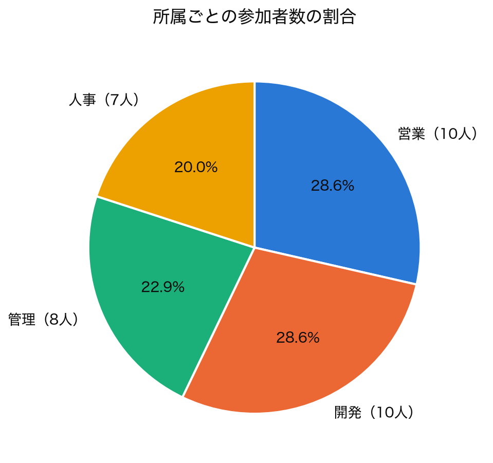
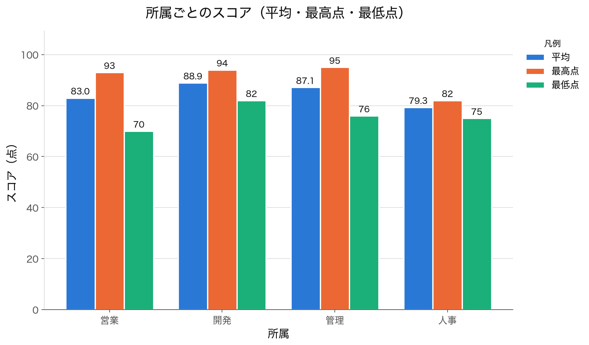
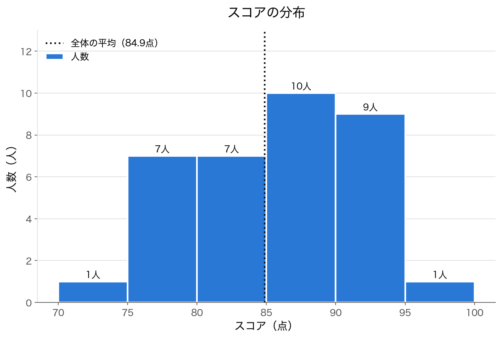

# グラフ作成プログラム（AIエンジニア講座 課題3）

CSVファイルから参加者の所属とスコアを読み込み、3つのグラフを作って画像として保存する Python プログラムです。

## 作成されるグラフ

### 円グラフ：所属ごとの参加者数の割合



### 棒グラフ：所属ごとのスコア（平均・最高点・最低点）



### ヒストグラム：スコアの分布



## 使い方

1. pandas と matplotlib をインストールします（Anaconda を使っている場合は最初から入っています）。

   ```bash
   pip install pandas matplotlib
   ```

2. 講座の配布フォルダから `課題3.csv` を入手し、`data` フォルダを作ってその中に置きます。
   （CSV は講座の教材のため、このリポジトリには含めていません）

3. プログラムを実行します。

   ```bash
   python main.py
   ```

4. `output` フォルダに3つの画像が保存されます。

## 入力データの形式

`data/課題3.csv` は、次の3列を持つ CSV ファイルです。

| 列名 | 内容 | 例 |
|---|---|---|
| 名前 | 参加者名 | 佐藤 |
| 所属 | 所属する部署 | 営業 |
| スコア | 点数（整数） | 85 |

## ファイル構成

```
├── main.py            # プログラム本体
├── data/
│   └── 課題3.csv      # 入力データ（各自で用意）
├── output/            # グラフ画像の保存先
│   ├── pie_chart.png
│   ├── bar_chart.png
│   └── histogram.png
└── 要件定義書.md      # 作る前に決めた内容
```

## 使用技術

- Python 3
- pandas（集計）
- matplotlib（グラフ作成）

## 補足

このプログラムは、AI ツール（Claude Code）と対話しながら作成しました。
